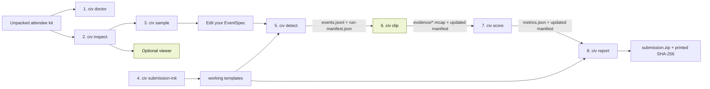

# Quickstart: unpacked kit to accepted bundle

First install the participant CLI using the [setup instructions](setup.md). Use native Windows AMD64 or native Linux AMD64; WSL2 is an optional Linux route on Windows. Run these steps from the root of the unpacked attendee kit with its supplied local recordings, EventSpecs and practice labels. Once the CLI and those inputs are available, the core workflow does not need a network connection. See [runtime requirements](runtime-requirements.md). Commands below use the Kashiwa warm-up. For Reims, use `examples/reims/left_turn.yaml` and `layouts/reims-left-turn.pj4.xml` with the matching Reims MCAP.

## Install before the first command

With Git and uv available, run in PowerShell or a Linux shell while connected:

```text
uv tool install --python 3.12 "git+https://github.com/Forerunner2012/civ2026-data-hackathon.git@main#subdirectory=participant"
uv tool update-shell
```

Restart your shell, then run `civ --help`. Follow [setup and recovery](setup.md) if access, PATH, Python or the matching wheel backup needs attention. After installation, run the steps below from the root of the unpacked kit.

## The route at a glance



The viewer and evidence clips help your investigation but stay on your machine. Only the validated metadata bundle is submitted.

## Before step 1: choose local paths

Use the supplied files; do not rename or edit kit inputs:

```text
BAG=data/KSH-64ac27cd029b-signals.mcap
SPEC=examples/kashiwa/right_turn.yaml
LAYOUT=layouts/kashiwa-right-turn.pj4.xml
WORK=working
```

The examples below spell those paths out so they work in PowerShell and POSIX shells alike.

## 1. Check the environment

```text
civ doctor --workspace . --bag data/KSH-64ac27cd029b-signals.mcap --layout layouts/kashiwa-right-turn.pj4.xml --offline-kit .
```

The command checks the current writable kit directory before `working/` exists. If the kit directory is read-only, pass another existing writable directory with `--workspace`. Do not pre-create `working/`; step 4 creates the submission workspace.

Expected result: `Doctor: READY`. This command downloads, installs, and writes nothing. If it exits 2, follow the printed `Action:` for the failing check and rerun the same command. Use the viewer shipped under `viewer/<your-platform>/`; its local instructions are in `viewer/README.md`.

## 2. Inventory topics and fields

```text
civ inspect data/KSH-64ac27cd029b-signals.mcap
```

Expected result: bag duration followed by topics, message counts, rates, and fields. This is read only. A missing topic is not in this bag; confirm the exact dataset path before changing a detector.

## 3. Sample one signal and look at the recording

```text
civ sample data/KSH-64ac27cd029b-signals.mcap --topic /pix_hooke/v2a_steerstafb --field vcu_chassis_steer_angle_fb --limit 4
```

Expected result: up to four timestamped values printed to the terminal. Nested fields use dotted paths; `--start-ns` and `--end-ns` narrow the window. This command writes nothing.

For a visual inspection, open the same signal MCAP and `layouts/kashiwa-right-turn.pj4.xml` in the supplied PlotJuggler. In Lichtblick, open the signal MCAP together with its same-source companion from `context/kashiwa/`, then load `layouts/lichtblick-kashiwa-right-turn.json`. Do not mix source IDs. If a viewer does not start, continue with `civ sample` or the supplied `fallback/` material.

## 4. Create your working submission once

```text
civ submission-init working --shell powershell
```

Use `--shell posix` on Linux or macOS. This creates `working/README.md`, an incomplete detector, report and figure template, plus exactly one reproduction script. It never overwrites an existing directory. If `working/` already exists, keep it or choose a new empty path.

## 5. Detect intervals

First run the supplied EventSpec without writing:

```text
civ detect examples/kashiwa/right_turn.yaml data/KSH-64ac27cd029b-signals.mcap --output working --dry-run
```

Then copy the relevant logic into `working/detector/detector.yaml`, make one evidence-led change, and write the run:

```text
civ detect working/detector/detector.yaml data/KSH-64ac27cd029b-signals.mcap --output working
```

Expected result: `working/events.jsonl`, a byte-for-byte EventSpec copy under `working/detector/`, and `working/run-manifest.json`. Inputs are never rewritten. If zero events appear, loosen one condition or timing value and rerun `--dry-run` before writing again.

## 6. Extract local evidence

```text
civ clip working/events.jsonl data/KSH-64ac27cd029b-signals.mcap
```

With detections, expect one `working/evidence/<event_id>.mcap` per event and clip facts added to the run manifest. Reopen a clip in a supplied viewer. With zero events, the command writes no clips; inspect your conditions and timing, then continue to scoring and reporting to record the result. A failure names the missing topic or empty window; every `evidence.topics` entry must exist in the same bag used by `civ detect`.

## 7. Score against the supplied development labels

```text
civ score working --labels <supplied-development-labels.json>
```

Use the complete practice pack matched to the exact source and event definition announced for your kit. Do not substitute organizer truth, a partial answer key, or labels for a different event. The repository's reserved practice-labels folder contains no real label JSON; use the pack supplied for your session. If labels are unavailable, ask a coach before scoring. Expected result: `working/metrics.json` plus its hash in the updated run manifest. Inspect at least one false positive, false negative, boundary error, or ambiguity and record what you changed in `working/report.md`.

## 8. Validate, package, and submit

Complete the five report headings, replace the figure, and make the reproduction script rerun the same path. Then:

```text
civ report working
```

Expected result: `working/submission.zip` and its SHA-256 printed to the terminal. Submit the ZIP unchanged with the printed hash and your participant/team identity through the form shown on the live page. If the form is unavailable, give those same three items to the organizer by USB.

No bag and no clip is ever bundled. Signal and context MCAPs, extracted frames, and `working/evidence/` stay local.

## Command products and dependencies

| Order | Command | Reads | Prints or writes | Used by |
| ---: | --- | --- | --- | --- |
| 1 | `civ doctor` | kit, bag, layout, workspace path | readiness only; no files | your recovery decision |
| 2 | `civ inspect` | MCAP | topic/field inventory; no files | `sample`, EventSpec design |
| 3 | `civ sample` | MCAP + topic + field | timestamped values; no files | EventSpec design, report figure |
| 4 | `civ submission-init` | built-in templates | detector/report/figure/reproduction templates | `detect`, `report` |
| 5 | `civ detect` | EventSpec + MCAP + declared resources | `detector/` with exact resources, `events.jsonl`, v2 `run-manifest.json`, optional `extension/manifest.json` | `clip`, `score`, `report` |
| 6 | `civ clip` | events + same MCAP + manifest | `evidence/*.mcap`, updated manifest | visual review, `report` manifest checks |
| 7 | `civ score` | working directory + supplied labels | `metrics.json`, updated manifest | report argument, `report` |
| 8 | `civ report` | completed working directory | `submission.zip` + SHA-256 | organizer intake |

## Working directory versus submission

```text
working/
├── detector/detector.yaml      submitted
├── detector/<resource path>    submitted when declared by EventSpec
├── events.jsonl                submitted
├── run-manifest.json           submitted
├── metrics.json                submitted
├── report.md                   submitted
├── figure.svg                  submitted
├── reproduce.ps1 or .sh        submitted
├── extension/manifest.json     submitted when extension payloads exist
├── extension/*                 optional provenance, inert traces, tests
├── submission.zip              hand in unchanged
└── evidence/<event_id>.mcap    local only
```

The seven core artifacts remain mandatory. A v2 extension may carry at most eight declared payloads (1 MiB each, 4 MiB combined). `civ report` rejects undeclared, changed, forbidden, unsafe, or case-colliding files. Intake validates but never runs a submitted trace or regression test.

## Recovery references

- Viewer problem: use `civ sample` and `fallback/<dataset>/`, then raise the printed help card.
- CLI setup problem: follow [setup and recovery](setup.md), or pair with another participant while a coach helps. Container recovery is optional.
- Command problem: read the exact diagnostic, fix only the named input, and rerun that command.
- Submission problem: rerun `civ report`; never manually edit or recompress `submission.zip`.
