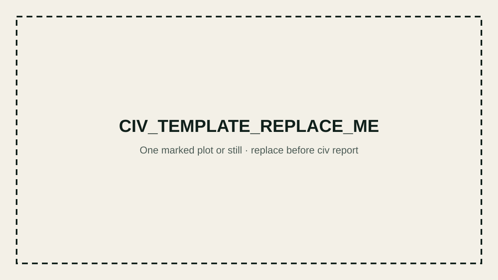

# Question and hypothesis

CIV_TEMPLATE_REPLACE_ME: State the engineering question and your falsifiable detection hypothesis.

# Signals used, missing, or unreliable

CIV_TEMPLATE_REPLACE_ME: Name the fields, units, limitations, and evidence you did not have.

# What transferred and what did not

CIV_TEMPLATE_REPLACE_ME: Separate the stable contract from dataset-specific bindings and values.

# One failure and the resulting change

CIV_TEMPLATE_REPLACE_ME: Show one false positive, miss, boundary ambiguity, duplicate, or data gap.

# Downstream action and deployment mode

CIV_TEMPLATE_REPLACE_ME: Recommend the next action and state whether this is offline analysis,
monitoring, triage, or another bounded deployment mode.
